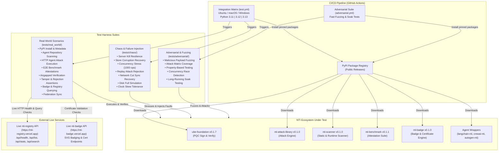

# nti-integration-test

Ecosystem integration test suite for Neural Trust Infrastructure (NTI).

This repository proves that all core NTI packages work together directly from public PyPI.

## NTI Package Version Pinning

| Package | Version |
| :--- | :--- |
| `ube-foundation` | `0.1.7` |
| `nti-attack-library` | `0.1.0` |
| `nti-scanner` | `0.1.0` |
| `nti-benchmark` | `0.1.1` |
| `nti-badge` | `0.1.0` |

## Integration Chains

- **Chain 01:** `ube-foundation` sign and verify
- **Chain 02:** `nti-attack-library` load & registered attacks
- **Chain 03:** `nti-scanner` scan directory on real targets
- **Chain 04:** `nti-attack` report verified by `ube-foundation`
- **Chain 05:** `nti-benchmark` signed attestations
- **Chain 06:** `nti-badge` certificate rendering & live registry read endpoints
- **Chain 07:** Registry federation manifest synchronization
- **Chain 08:** Tamper detection and signature rejection

## Real-World Scenarios (`tests/real_world/`)

1. **Fresh PyPI Environment:** Verify imports and metadata from public PyPI packages.
2. **Real Agent Scan:** Scan realistic LangChain repository structure with `nti-scanner`.
3. **HTTP Agent Attack:** Execute attack library against a real local HTTP agent server to produce signed reports.
4. **End-to-End Benchmark:** Run benchmark suite end-to-end and verify signed attestations.
5. **Airgapped Verification:** Verify signed reports in an airgapped/offline mode with zero external network calls.
6. **Tamper Detection:** Modify certificates, payload fields, or public keys and assert signature verification rejection.
7. **Badge & Live Registry:** Render SVG badges and verify live registry endpoints (`/api/health`, `/api/list`, `/api/stats`, `/api/search`).
8. **Federation Synchronization:** Reconcile manifests and endpoints between multiple registry nodes.

## Chaos & Failure Injection (`tests/chaos/`)

1. **Server Kill Resilience:** Terminate badge server mid-request and verify clean client exception handling + restart recovery.
2. **Corrupt Local Store:** Inject binary garbage into persistent KV/file store and verify automatic corruption detection + state rebuild.
3. **High Concurrency Verification:** Execute 1,000 concurrent signature verifications in parallel with memory stability assertions.
4. **Certificate Replay Prevention:** Replay signed certificates 100 times and assert rejection after the initial submission.
5. **Network Cut During Federation:** Disconnect network during federation sync and verify reconciliation once reconnected.
6. **Disk Full Simulation:** Simulate `ENOSPC` (`OSError(28)`) during report export and verify graceful error handling.
7. **Clock Skew Bounds:** Validate timestamp tolerance windows (±5 minutes) under clock skew conditions.

## Running Tests Locally

```bash
# Install editable package and testing tools
pip install -e . ruff mypy types-requests

# Run full test suite with random test order and parallel workers
pytest -n auto --random-order -v

# Run Real-World Scenarios
pytest tests/real_world/ -v

# Run Chaos & Failure Injection Suite
pytest tests/chaos/ -v

# Run Fast Adversarial Suite
pytest tests/adversarial/ -v -m "not soak"

# Run Soak Test Suite
pytest tests/adversarial/ -v -m "soak"

# Code Quality and Type Checking
ruff check .
mypy --strict tests/
```

## CI Matrix

Tests are automatically executed on GitHub Actions across:
- **Operating Systems:** `ubuntu-latest`, `macos-latest`, `windows-latest`
- **Python Versions:** `3.11`, `3.12`, `3.13`

## Architecture


